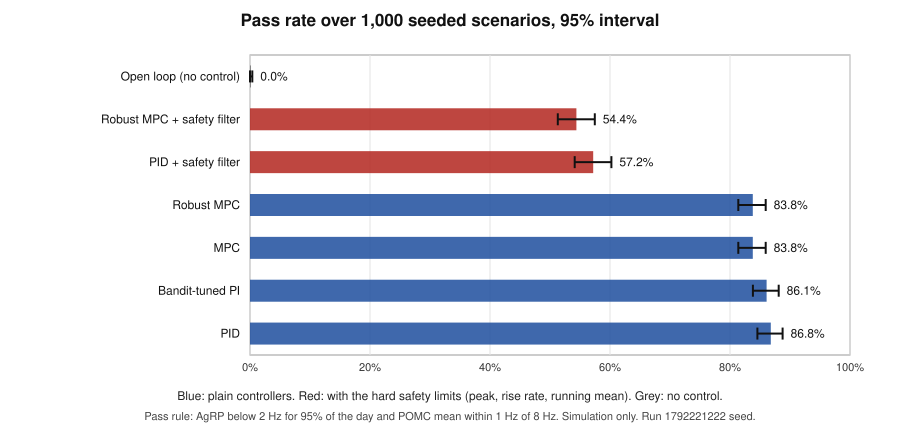

# gaden-health-demo

[](https://github.com/braylo777/gaden-health-demo/actions/workflows/ci.yml)
[](https://gaden.braylo.si)


A simulation of a closed-loop controller for the brain's hunger circuit. It runs in Rust, and in your browser as WebAssembly. Paper: "Closed-Loop Electrochemical Neural Interfaces for Hypothalamic Appetite Regulation".

> **Simulation only.** This is a computer model. It is not a medical device and not medical advice. It is not a cure. It is not tested in animals or people. It makes no health claim. Do not use it to make decisions about food, sleep, drugs or treatment.

**[Live demo](https://gaden.braylo.si)** · **[How Gaden works (paper, PDF)](docs/HOW-GADEN-WORKS.pdf)** · [same text as Markdown](docs/HOW-GADEN-WORKS.md) · [sources](data/SOURCES.md)

## Results (v1.0.0)

Measured on <!--n:generated_date-->2026-11-24<!--/n--> with `make metrics` at commit <!--n:git_sha-->572896f<!--/n-->, <!--n:machine-->macos aarch64, 12 cores, rustc 1.100.0 (0ef1bc386 2026-11-09), Apple M2 Pro<!--/n-->. All numbers are **simulation** results from [`results/metrics.json`](results/metrics.json). CI checks that this table equals the JSON (`scripts/readme_numbers.py --check`) and that a fresh run reproduces it.

| Metric | Value |
|---|---|
| Stress scenarios (shift work, illness, travel, missed meals, sensor noise; seeded) | **<!--n:scenarios-->1,000<!--/n-->** |
| Pass rate, best controller (<!--n:best_controller-->pid<!--/n-->) | **<!--n:best_pass-->86.8%<!--/n-->** (95% interval <!--n:ci_pid-->84.6 to 88.8%<!--/n-->) |
| Pass rate with hard safety limits (<!--n:best_safe_controller-->safe_pid<!--/n-->) | **<!--n:best_safe_pass-->57.2%<!--/n-->** |
| Pass rate, no control | <!--n:open_pass-->0.0%<!--/n--> |
| AgRP peak, nominal day: closed loop / open loop | **<!--n:agrp_peak-->1.04 Hz<!--/n-->** / <!--n:agrp_peak_open-->30.0 Hz<!--/n--> |
| Tests | **<!--n:tests-->496<!--/n-->**, all passing (+ 7 Python) |
| Line coverage (library) | <!--n:coverage-->97.6%<!--/n--> |
| Fit to published values, relative RMSE | <!--n:fit_rmse-->0.012<!--/n--> in sample; **<!--n:fit_loo-->0.55<!--/n-->** leave-one-out |
| Time per simulated day (native) | <!--n:ms_per_day-->12.3 ms<!--/n--> |

A day **passes** if AgRP stays below 2 Hz for at least 95% of the day, the POMC mean is within 1 Hz of 8 Hz, and all states are finite and bounded.

### Controller benchmark (<!--n:scenarios-->1,000<!--/n--> scenarios each)

| Controller | Pass | 95% interval | Worst AgRP | Mean AgRP current |
|---|---|---|---|---|
| PID | <!--n:pass_pid-->86.8%<!--/n--> | <!--n:ci_pid-->84.6 to 88.8%<!--/n--> | <!--n:worst_pid-->16.5 Hz<!--/n--> | <!--n:u_pid-->14.5 uA<!--/n--> |
| MPC | <!--n:pass_mpc-->83.8%<!--/n--> | <!--n:ci_mpc-->81.4 to 86.0%<!--/n--> | <!--n:worst_mpc-->16.5 Hz<!--/n--> | <!--n:u_mpc-->14.5 uA<!--/n--> |
| Robust MPC | <!--n:pass_rmpc-->83.8%<!--/n--> | <!--n:ci_rmpc-->81.4 to 86.0%<!--/n--> | <!--n:worst_rmpc-->16.5 Hz<!--/n--> | <!--n:u_rmpc-->14.5 uA<!--/n--> |
| Bandit-tuned PI | <!--n:pass_bandit-->86.1%<!--/n--> | <!--n:ci_bandit-->83.8 to 88.1%<!--/n--> | <!--n:worst_bandit-->17.8 Hz<!--/n--> | <!--n:u_bandit-->19.1 uA<!--/n--> |
| PID + safety filter | <!--n:pass_safe_pid-->57.2%<!--/n--> | <!--n:ci_safe_pid-->54.1 to 60.2%<!--/n--> | <!--n:worst_safe_pid-->25.4 Hz<!--/n--> | <!--n:u_safe_pid-->13.7 uA<!--/n--> |
| Robust MPC + safety filter | <!--n:pass_safe_rmpc-->54.4%<!--/n--> | <!--n:ci_safe_rmpc-->51.3 to 57.5%<!--/n--> | <!--n:worst_safe_rmpc-->25.4 Hz<!--/n--> | <!--n:u_safe_rmpc-->13.8 uA<!--/n--> |
| Open loop | <!--n:pass_open-->0.0%<!--/n--> | <!--n:ci_open-->0.0 to 0.4%<!--/n--> | <!--n:worst_open-->46.4 Hz<!--/n--> | <!--n:u_open-->0.0 uA<!--/n--> |



Robust MPC does not beat plain MPC here. The failures are mostly a current limit, not a control-law problem: when the drive is larger than 40 uA can cancel, no controller can win. The safety filter costs about 30 points of pass rate. The running-mean limit is the cause. The [paper](docs/HOW-GADEN-WORKS.md) has the breakdown by scenario kind and a failure gallery.

## What is in the model

Ghrelin, leptin, insulin, GLP-1, PYY, cortisol, glucose, gastric emptying and cumulative sleep debt, with circadian timing, meals, sleep loss, stress, illness, time-zone shift and a GLP-1 agonist dose. Every parameter is cited or marked as an assumption in [`data/SOURCES.md`](data/SOURCES.md). Terms from 2015 on are tested against a published value (or its direction) in `rust/tests/terms.rs`:

| Check | Published | Model |
|---|---|---|
| First-hour gastric emptying with the agonist (Hjerpsted 2018) | 0.73 (0.61 to 0.87) | <!--n:gastric_ratio-->0.73<!--/n--> |
| Postprandial glucose at 12 h body-clock misalignment (Morris 2015) | 1.06 | <!--n:misalign_ratio-->1.030<!--/n--> |
| Cortisol peak after waking (Stalder 2016) | 30 to 45 min | <!--n:car_min-->42<!--/n--> min |

## Limitations: read these

- **It is a simulation.** Nothing here measures a person or an animal.
- **Summary values, not time series.** The fit uses 9 numbers from abstracts (1993 to 2004). It is exactly determined. The leave-one-out error is the honest number. The model does **not** predict a held-out value well.
- **No AgRP or POMC data.** The weights from hormones to firing rate are assumptions. Mouse data (Mandelblat-Cerf 2015) set only the direction.
- **One known mismatch.** A 2018 trial found lower postprandial insulin with an agonist. The model gives higher insulin.
- **Assumed parts:** PYY scale, cortisol amplitude, stress and illness effects, sleep-debt time constant, drug kinetics, the safety-limit values.
- **Toy plant.** First order, one time constant. Real hypothalamic dynamics are not known here.
- **Stability** is tested by random sampling and a linearised check. It is not a formal proof.
- Chapter 4 of the paper (electrochemistry, tissue safety) is not modelled.
- The pass rule is a design choice. Another rule gives other numbers.

## Run it

```bash
make test          # Rust tests
make metrics       # 1,000 scenarios x 7 controllers -> results/metrics.json (1 to 6 min)
make readme        # rewrite the numbers above from the JSON
make check         # fail if README or docs differ from the JSON
sh web/build.sh    # build the browser demo (rustup target add wasm32-unknown-unknown)
docker build -t gaden . && docker run --rm gaden           # one simulated day
docker run --rm gaden suite 50 safe_pid                    # 50 scenarios
```

Python reference (v0.1):

```bash
pip install numpy matplotlib pytest
python -m pytest -q
python -m gaden demo
```

## Layout

| Path | What it is |
|---|---|
| `rust/src/hormones.rs` | Hormone model, cortisol, PYY, sleep debt, neural drive |
| `rust/src/controllers.rs` | PID, MPC, robust MPC, bandit, safety filter |
| `rust/src/sim.rs` | 24 h closed loop, 240- and 1,000-scenario suites, Wilson interval |
| `rust/src/anchors.rs` | The literature checks above |
| `rust/src/fit.rs` | Fit and leave-one-out check |
| `rust/src/bin/metrics.rs` | Writes `results/metrics.json` |
| `rust/tests/` | 496 tests: terms, safety, stress, golden curves, Python parity |
| `wasm/`, `web/` | Browser demo (C-ABI WebAssembly, no npm, no libraries) |
| `docs/` | Paper (Markdown and PDF) and 5 SVG figures |
| `scripts/` | README number check, claims check, figure and PDF builders |
| `gaden/` | v0.1 Python reference |
| `data/` | Cited targets, sources, fit result |

See [`CHANGELOG.md`](CHANGELOG.md).
