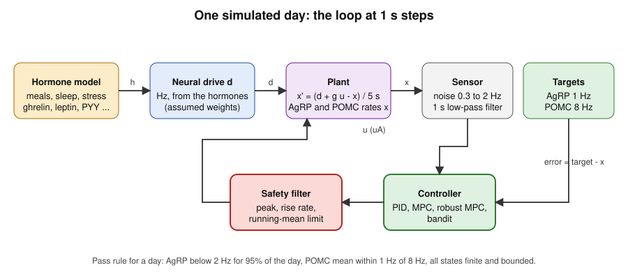
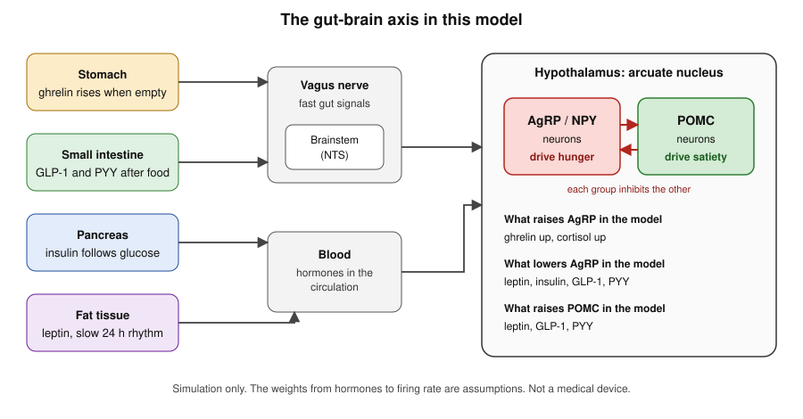
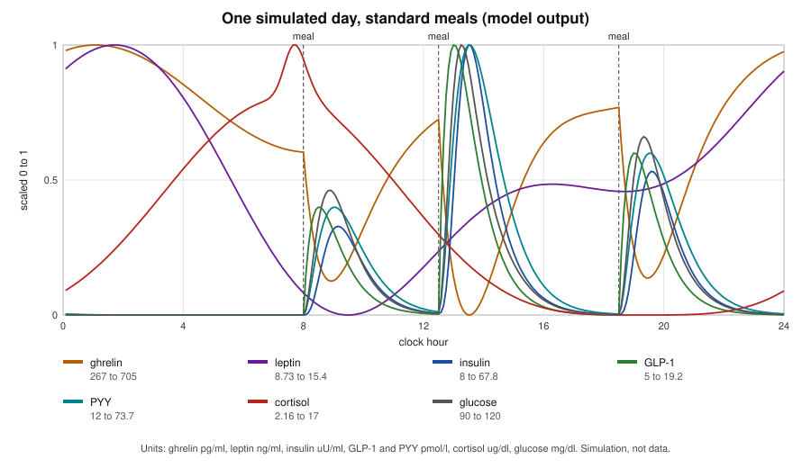
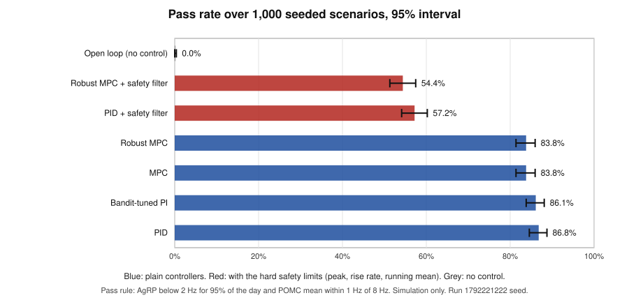
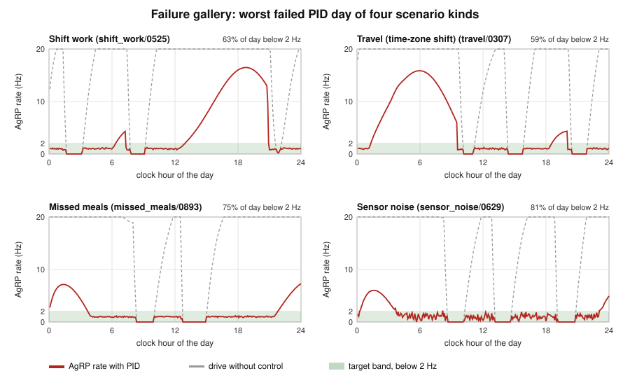

# How Gaden works

> **Simulation only.** This is a computer model. It is not a medical device. It is not a cure and it makes no health claim. It is not tested in animals or people. Do not use it to make decisions about food, sleep, drugs or treatment.

Numbers in this paper come from `results/metrics.json`. It was made on <!--n:generated_date-->2026-11-24<!--/n--> at commit <!--n:git_sha-->c60d003-dirty<!--/n--> with `make metrics`. Machine: <!--n:machine-->macos aarch64, 12 cores, rustc 1.100.0 (0ef1bc386 2026-11-09), Apple M2 Pro<!--/n-->. Every number is a **simulation** result unless the text says it is a published value.

## 1. The problem: hunger is a control loop

A body keeps its energy supply in a narrow range. It does this with feedback. When food is missing, hunger signals rise. When food arrives, they fall.

Gaden asks one engineering question. Suppose a stimulation device could read the firing rate of the hunger neurons and push it back toward a target. Which control law keeps the rate in a target band on the days that go wrong?

The paper behind Gaden proposes such a closed-loop device. This repository does not build a device. It builds a **simulation** of the loop. The simulation lets us test control laws on many days that differ in meals, sleep, stress, travel, illness and sensor noise. Nothing here shows that a real device would work.



*Figure 1. One simulated day. The loop runs at 1 s steps for 86,400 steps.*

## 2. The biology in this model: the gut-brain axis

Hunger is not one signal. Many organs send signals to a small group of neurons in the hypothalamus. This group is the arcuate nucleus.

- The stomach makes **ghrelin** when it is empty. Ghrelin raises hunger.
- The small intestine makes **GLP-1** and **PYY** when food arrives. They lower hunger.
- The pancreas makes **insulin** when glucose rises.
- Fat tissue makes **leptin**. Leptin follows a slow 24-hour rhythm.
- The adrenal gland makes **cortisol**. It has a daily rhythm and a rise after waking.
- Some gut signals travel through the **vagus nerve** and the brainstem. Others travel in the blood.

In the arcuate nucleus two neuron groups work against each other. **AgRP/NPY neurons** drive hunger. **POMC neurons** drive satiety. In a mouse study, AgRP firing rose with a growing calorie deficit, and putative POMC neurons changed the opposite way (Mandelblat-Cerf 2015). This model uses the same direction.



*Figure 2. The signals in the model. The weights from hormones to firing rate are assumptions.*

## 3. The model

Time is in seconds. The clock hour is `h`. All equations are integrated with Euler steps. Parameter names match `rust/src/hormones.rs`. Sources are in `data/SOURCES.md`.

### 3.1 State and units

| Symbol | Meaning | Unit |
|---|---|---|
| G | ghrelin | pg/ml |
| L | leptin | ng/ml |
| I | insulin | uU/ml |
| P | GLP-1 | pmol/l |
| Y | PYY | pmol/l |
| C | cortisol | ug/dl |
| u (glucose) | blood glucose | mg/dl |
| S, T | carbohydrate in stomach, in gut | g |
| D | cumulative sleep debt | 0 to 1 |
| A | agonist drug level | dose units |

### 3.2 Equations

Each hormone moves toward a target with a time constant: `dX/dt = (X_target - X) / tau_X`.

- **Sleep debt.** The acute severity is `d = clamp((10 - sleep_h) / 6, 0, 1)`. It is 0 at 10 h in bed and 1 at 4 h or less. The cumulative debt follows `dD/dt = (d - D) / 36 h`. The 36 h time constant is an assumption.
- **Leptin.** `L_target = L0 * shape(h - shift) * (1 - s_L d)`, with `shape = 1 + a1 cos(w (h - p1)) + a2 cos(2 w (h - p2))` and `w = 2 pi / 24 h`. `shift` is how many hours the body clock is behind the day clock.
- **Gastric emptying.** `dS/dt = - k_e S / (1 + kappa A)`. The agonist slows emptying. `kappa = 1.05` makes the first-hour emptying ratio equal <!--n:gastric_ratio-->0.73<!--/n--> (published: 0.73, interval 0.61 to 0.87).
- **Gut.** `dT/dt = k_e S / (1 + kappa A) - k_a T`.
- **Ghrelin.** `G_target = G0 * circ * (1 + r (1 - exp(-t_meal / tau_f))) * (1 + s_G d) * (1 - 0.35 illness) / (1 + 0.9 (S + T) / 50)`. It rises with time since the last meal and falls when food is in the gut.
- **GLP-1.** `P_target = 5 + 500 * (emptying flow)`.
- **PYY.** `Y_target = 12 + 1.2 T`, with a 30 min time constant. The scale is an assumption.
- **Glucose.** `du/dt = T k_a - k_g (u - 90) - f_align * 0.012 * (I - I0) * (u / 90) / 60`. `f_align = 1 - 0.6 * |shift| / 12`. Misalignment between body clock and day lowers insulin action.
- **Insulin.** `I_target = I0 + 1.2 * max(u - 90, 0) * (1 + 0.08 * max(P_total - P0, 0))`. `P_total` adds the agonist.
- **Cortisol.** `C_target = [2 (1 + 0.35 D) + 12 * circ^2 + CAR] * (1 + 0.6 stress + 0.3 illness)`. `circ` peaks at 07:00 by the body clock. `CAR = 4 * exp(-0.5 ((h - wake - 0.5 h) / 0.3 h)^2)` is the awakening response. Wake time is 23:00 plus sleep hours. The peak comes <!--n:car_min-->42<!--/n--> min after waking (published: 30 to 45 min, Stalder 2016).
- **GLP-1 agonist.** First-order absorption (6 h) and clearance (24 h). These rates are assumptions.

### 3.3 From hormones to firing rate

The neural drive `d` is the AgRP and POMC rate the neurons would have without a device. The weights are **assumptions**. No human firing data was found to fit them.

```
AgRP = 8 + w_ghr g - 6 l - 0.6 i - 0.15 (P_total - P0) - 0.08 (Y - Y0) + 0.25 (C - 7.5)
POMC = 3 + 2 l + 0.04 (P_total - P0) + 0.02 (Y - Y0)
```

`g`, `l` and `i` are relative changes from the basal value. `w_ghr` is calibrated each run so that the open-loop nominal day peaks at 30 Hz. This keeps the scale of version 0.1.

### 3.4 Plant

The plant is a first-order system: `x' = (d + g u - x) / tau`, with `tau = 5 s`. The gain is `g = -1 Hz/uA` for AgRP (current lowers the rate) and `+0.5 Hz/uA` for POMC. The current `u` is limited to 40 uA (AgRP) and 25 uA (POMC). Each scenario draws a gain error between 0.7 and 1.3 per channel.

### 3.5 What is fitted and what is not

Nine summary numbers from four abstracts (1993 to 2004) are fitted with nine free parameters. The fit is exactly determined. The in-sample error is <!--n:fit_rmse-->0.012<!--/n-->. The leave-one-out error is <!--n:fit_loo-->0.55<!--/n-->. The leave-one-out error is the honest number. It shows that the model does **not** predict a held-out value well.

The terms added in version 1.0 (PYY, cortisol, sleep debt, gastric slowing, misalignment) use papers from 2015 on. Each term has a bound test and a literature-value test in `rust/tests/terms.rs`. Where a paper gives no number, the test checks direction only.

| Term | Literature value | Model value |
|---|---|---|
| First-hour gastric emptying, agonist vs none (Hjerpsted 2018) | 0.73 (0.61 to 0.87) | <!--n:gastric_ratio-->0.73<!--/n--> |
| Postprandial glucose at 12 h misalignment (Morris 2015) | 1.06 | <!--n:misalign_ratio-->1.030<!--/n--> |
| Cortisol peak after waking (Stalder 2016) | 30 to 45 min | <!--n:car_min-->42<!--/n--> min |

One published result is **not** reproduced. Hjerpsted 2018 found a lower postprandial insulin area with the agonist. The model gives a higher one, because of its incretin term. A test (`lit_insulin_agonist_mismatch_is_known`) marks this gap.



*Figure 3. The seven hormone curves on the standard day (model output). Each curve is scaled to its own range.*

## 4. Controllers

All controllers see only the noisy, filtered AgRP and POMC rates. They set the current `u`. All outputs stay inside the device limits.

| Name | What it is |
|---|---|
| `pid` | PID with derivative on the measurement and conditional-integration anti-windup. |
| `mpc` | Offset-free model-predictive control on a first-order model. The input is constant over a 20-step horizon, so the optimum has a closed form. |
| `rmpc` | Robust MPC. It minimises the worst-case tracking error over plant gains of 0.7, 1.0 and 1.3 times nominal. The worst case of convex quadratics has an exact solution at a bound, a minimum or a crossing. The solver tries all of these. |
| `bandit` | Epsilon-greedy choice among five PI gain multipliers, scored every 60 s. A minimal learning baseline. |
| `safe_pid`, `safe_rmpc` | The controller above, behind a **safety filter**. |

The **safety filter** enforces three hard limits for any input, including NaN, infinity and negative values:

1. The current stays between 0 and a peak (38 uA for AgRP, 23.75 uA for POMC, 95% of the device limit).
2. The current may rise by at most 10 uA per second. Falls are not limited.
3. The running mean over a 1 h window stays below 28 uA (AgRP) and 17.5 uA (POMC).

A property test draws 10,000 random trials with an adversarial inner controller and checks all three limits at every step. These limit values are design assumptions for this simulation. They are not clinical limits.

## 5. Results

The stress suite has <!--n:scenarios-->1,000<!--/n--> scenarios. A fixed seed makes it reproducible. It has five kinds, <!--n:n_shift_work-->200<!--/n--> each: shift work, illness, travel across time zones, missed meals, and sensor noise from 0.5 to 2 Hz. Each scenario also draws a plant gain error, and 30% include an agonist dose.

A day **passes** if AgRP stays below 2 Hz for at least 95% of the day, the POMC mean is within 1 Hz of 8 Hz, and all states are finite and bounded.

| Controller | Pass | 95% interval | Worst AgRP | Mean AgRP current |
|---|---|---|---|---|
| PID | <!--n:pass_pid-->86.8%<!--/n--> | <!--n:ci_pid-->84.6 to 88.8%<!--/n--> | <!--n:worst_pid-->16.5 Hz<!--/n--> | <!--n:u_pid-->14.5 uA<!--/n--> |
| MPC | <!--n:pass_mpc-->83.8%<!--/n--> | <!--n:ci_mpc-->81.4 to 86.0%<!--/n--> | <!--n:worst_mpc-->16.5 Hz<!--/n--> | <!--n:u_mpc-->14.5 uA<!--/n--> |
| Robust MPC | <!--n:pass_rmpc-->83.8%<!--/n--> | <!--n:ci_rmpc-->81.4 to 86.0%<!--/n--> | <!--n:worst_rmpc-->16.5 Hz<!--/n--> | <!--n:u_rmpc-->14.5 uA<!--/n--> |
| Bandit-tuned PI | <!--n:pass_bandit-->86.1%<!--/n--> | <!--n:ci_bandit-->83.8 to 88.1%<!--/n--> | <!--n:worst_bandit-->17.8 Hz<!--/n--> | <!--n:u_bandit-->19.1 uA<!--/n--> |
| PID + safety filter | <!--n:pass_safe_pid-->57.2%<!--/n--> | <!--n:ci_safe_pid-->54.1 to 60.2%<!--/n--> | <!--n:worst_safe_pid-->25.4 Hz<!--/n--> | <!--n:u_safe_pid-->13.7 uA<!--/n--> |
| Robust MPC + safety filter | <!--n:pass_safe_rmpc-->54.4%<!--/n--> | <!--n:ci_safe_rmpc-->51.3 to 57.5%<!--/n--> | <!--n:worst_safe_rmpc-->25.4 Hz<!--/n--> | <!--n:u_safe_rmpc-->13.8 uA<!--/n--> |
| Open loop | <!--n:pass_open-->0.0%<!--/n--> | <!--n:ci_open-->0.0 to 0.4%<!--/n--> | <!--n:worst_open-->46.4 Hz<!--/n--> | <!--n:u_open-->0.0 uA<!--/n--> |



*Figure 4. Pass rate with the Wilson 95% interval.*

Pass count by scenario kind (of 200 each):

| Controller | Shift work | Illness | Travel | Missed meals | Sensor noise |
|---|---|---|---|---|---|
| PID | <!--n:kind_shift_work_pid-->148/200<!--/n--> | <!--n:kind_illness_pid-->200/200<!--/n--> | <!--n:kind_travel_pid-->152/200<!--/n--> | <!--n:kind_missed_meals_pid-->185/200<!--/n--> | <!--n:kind_sensor_noise_pid-->183/200<!--/n--> |
| MPC | <!--n:kind_shift_work_mpc-->148/200<!--/n--> | <!--n:kind_illness_mpc-->200/200<!--/n--> | <!--n:kind_travel_mpc-->152/200<!--/n--> | <!--n:kind_missed_meals_mpc-->185/200<!--/n--> | <!--n:kind_sensor_noise_mpc-->153/200<!--/n--> |
| Robust MPC | <!--n:kind_shift_work_rmpc-->148/200<!--/n--> | <!--n:kind_illness_rmpc-->200/200<!--/n--> | <!--n:kind_travel_rmpc-->152/200<!--/n--> | <!--n:kind_missed_meals_rmpc-->185/200<!--/n--> | <!--n:kind_sensor_noise_rmpc-->153/200<!--/n--> |
| Bandit-tuned PI | <!--n:kind_shift_work_bandit-->146/200<!--/n--> | <!--n:kind_illness_bandit-->200/200<!--/n--> | <!--n:kind_travel_bandit-->148/200<!--/n--> | <!--n:kind_missed_meals_bandit-->184/200<!--/n--> | <!--n:kind_sensor_noise_bandit-->183/200<!--/n--> |
| PID + safety filter | <!--n:kind_shift_work_safe_pid-->67/200<!--/n--> | <!--n:kind_illness_safe_pid-->199/200<!--/n--> | <!--n:kind_travel_safe_pid-->77/200<!--/n--> | <!--n:kind_missed_meals_safe_pid-->113/200<!--/n--> | <!--n:kind_sensor_noise_safe_pid-->116/200<!--/n--> |
| Robust MPC + safety filter | <!--n:kind_shift_work_safe_rmpc-->67/200<!--/n--> | <!--n:kind_illness_safe_rmpc-->199/200<!--/n--> | <!--n:kind_travel_safe_rmpc-->77/200<!--/n--> | <!--n:kind_missed_meals_safe_rmpc-->113/200<!--/n--> | <!--n:kind_sensor_noise_safe_rmpc-->88/200<!--/n--> |

What the numbers say:

- **The simple controllers do about as well as the complex ones.** PID, MPC and the bandit are within a few points. Robust MPC gives the same pass rate as MPC. The failures are not caused by the control law.
- **Most failures are a limit, not a bug.** When the drive is larger than 40 uA can cancel at the gain of that day, no controller can win. Only a higher current limit or a second actuator can help.
- **Sensor noise hurts the model-based controllers.** MPC and robust MPC estimate a disturbance from the change in the measured rate. Noise makes that estimate poor. PID with a filtered derivative copes better.
- **Safety has a price.** The hard limits cut the pass rate by about 30 points. The running-mean limit is the main cause. It stops the controller from holding a high current through a long shift-work day. This is the trade-off the limits are for. Nothing here says where the right limit is.



*Figure 5. The worst failed PID day of four scenario kinds. The AgRP rate leaves the band when the drive is larger than the current limit can cancel.*

## 6. What this is NOT

- It is a **simulation**. It is not a measurement of any person or animal.
- It is **not a medical device** and not medical advice. It does not diagnose, treat or prevent any condition.
- It is **not a cure** and it makes no health claim.
- The weights from hormones to firing rate are **assumptions**. No human AgRP or POMC firing data was used.
- The fit uses 9 published summary numbers. It is exactly determined. It does not predict a held-out value well.
- The scale of PYY, the cortisol amplitude, the stress gain, the illness effect, the sleep-debt time constant and the drug kinetics are **assumptions**.
- The model does not reproduce the published fall in postprandial insulin with the agonist.
- Chapter 4 of the source paper (electrochemistry and tissue safety) is not modelled.
- The safety limits are design values for the simulation. They are not clinical limits.
- The pass rule is a design choice. A different rule gives different numbers.

## 7. Reproduce

```bash
git clone https://github.com/braylo777/gaden-health-demo && cd gaden-health-demo
make test        # <!--n:tests-->496<!--/n--> Rust tests
make metrics     # writes results/metrics.json (about 1 to 6 min)
make readme      # rewrite the README numbers from the JSON
make check       # fail if README or docs differ from the JSON
sh web/build.sh  # build the browser demo (needs the wasm32 target)
docker build -t gaden . && docker run --rm gaden
```

Line coverage of the library: <!--n:coverage-->97.6%<!--/n-->. One simulated day takes <!--n:ms_per_day-->13.8 ms<!--/n--> natively.

Sources for every term are in `data/SOURCES.md`.
